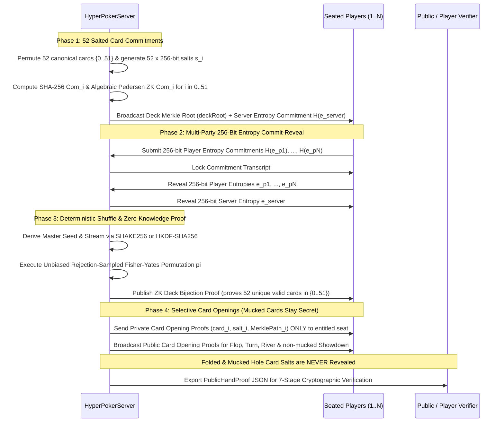

# PurrPoker Provably Fair & Zero-Knowledge RNG (`@purr-poker/rng`)

[](./LICENSE)
[](https://nodejs.org)
[](./circuits/deck_shuffle.circom)

Open-source cryptographic protocol, Zero-Knowledge prover/verifier, CLI auditor, and standalone Web Verifier for **PurrPoker's Provably Fair Card Dealing Engine**.

---

## Why This Upgrades Standard Mental Poker / CoinPoker RNG

### The Classic "Sealed Envelope" Trust Gap
In first-generation commit-reveal poker RNGs (such as CoinPoker):
> *"Here are 52 sealed envelopes. I promise there's a proper deck inside. Everyone contributes to randomly rearranging the envelopes. I'll let you open the envelopes you're entitled to see."*

Because folded and mucked hole cards must **never** be revealed after the hand (otherwise opponents in Heads-Up or multi-way pots could reconstruct your mucked bluffs), players only open the envelopes they were entitled to see. However, if 40+ envelopes remain sealed at the end of a hand, how does a player mathematically know the sealed envelopes didn't contain duplicate Aces or omit their outs?

### The PurrPoker Zero-Knowledge Upgrade
> *"Here are 52 sealed envelopes. **Here is also a mathematical Zero-Knowledge proof that the envelopes contain exactly one complete 52-card deck.** Everyone contributes 256-bit entropy to randomly rearranging them. You can only open envelopes you're entitled to see."*

| Security Property | Legacy Reveal-All RNG | Standard Commit-Reveal (CoinPoker) | **PurrPoker ZK Provably Fair RNG** |
| :--- | :---: | :---: | :---: |
| Pre-Hand Commitment Lock | ✅ | ✅ | ✅ **52 Salted Envelopes + Merkle Root** |
| Player + Server 256-Bit Entropy | ✅ | ✅ | ✅ **SHAKE256 / HKDF-SHA256** |
| Unbiased Fisher-Yates Shuffle | ⚠️ Often modulo-biased | ✅ | ✅ **32-Bit Rejection Sampling** |
| Mucked / Folded Cards Kept Secret | ❌ Leaks full deck post-hand | ✅ | ✅ **256-Bit Salts Permanently Withheld** |
| **Proof Deck Has 52 Unique Valid Cards Without Opening Mucked Cards** | ❌ Requires revealing full deck | ❌ Trust-based for unopened cards | ✅ **Zero-Knowledge Deck Bijection Proof** |

---

## Protocol Architecture



### 1. 52 Card Commitments with 256-Bit Salts (`src/commitments.ts`)
Before any entropy is revealed, the server assigns the 52 canonical cards $c_i \in \{0, \dots, 51\}$ into 52 envelopes, each sealed with an independent 256-bit CSPRNG salt $s_i \in \{0,1\}^{256}$:

$$\text{Com}_i = \text{SHA-256}(\text{"PURR\_CARD\_V1"} \parallel \text{handId} \parallel i \parallel c_i \parallel s_i)$$

Each envelope also carries an algebraic Pedersen commitment in a verified 256-bit safe-prime subgroup $\mathbb{G}_Q \subset \mathbb{Z}_P^*$ ($P = 2Q + 1$):

$$\text{ZKCom}_i = G^{c_i + 1} H^{r_i} \bmod P, \quad r_i = \text{H}_Q(\text{"PURR\_ZK\_BLINDING\_V1"} \parallel \text{handId} \parallel i \parallel s_i)$$

where $H$ is derived via Nothing-Up-My-Sleeve hashing (`SHA-256("PURR_PEDERSEN_H_NOTHING_UP_MY_SLEEVE_V1")^2 mod P`) so $\log_G(H)$ is unknown. All 52 envelopes are locked into a binary Merkle tree (`deckRoot`).

### 2. Multi-Party 256-Bit Entropy Commit-Reveal (`src/entropy.ts`)
1. **Commit**: The server and all seated players commit to 256-bit entropy seeds via $\text{SHA-256}(\text{"PURR\_ENTROPY\_V1"} \parallel \text{handId} \parallel \text{participantId} \parallel e)$.
2. **Lock & Reveal**: Only after all commitments are locked do participants reveal their 256-bit entropy seeds.
3. **Key Derivation (`SHAKE256` or `HKDF-SHA256`)**: The canonical transcript `(handId, deckRoot, serverEntropy, sortedPlayerEntropies)` is fed into **SHAKE256** (FIPS 202 XOF) or **HKDF-SHA256** (RFC 5869) to derive the 256-bit `masterSeedHex` and deterministic byte stream.

### 3. Unbiased Fisher-Yates Shuffle (`src/shuffle.ts`)
To rearrange the 52 sealed envelopes without modulo bias, for $i = 51$ down to $1$:
- Let $\text{range} = i + 1$ and $\text{rejectionLimit} = \lfloor 2^{32} / \text{range} \rfloor \times \text{range}$.
- Draw unsigned 32-bit integers $u \in [0, 2^{32}-1]$ from the `SHAKE256`/`HKDF` stream until $u < \text{rejectionLimit}$.
- Set $j = u \bmod \text{range}$ and swap envelope positions $i \leftrightarrow j$.

### 4. Selective Card Openings & Permanent Mucked-Card Privacy (`src/selective-opening.ts`)
- **Entitled Cards Only**: A player receives `(cardIndex, saltHex, merkleProof)` **only** for their own hole cards, community board cards (`FLOP`, `TURN`, `RIVER`), and active hands shown at `SHOWDOWN`.
- **Why Heads-Up Players Never Learn Mucked Cards**: Even in a 2-player Heads-Up hand where both players know all entropy seeds and the exact permutation $\pi$, an opponent only learns *which initial sealed envelope index $\pi(j)$* was dealt to the mucked seat. Because the 52 cards were pre-permuted into the 52 envelopes prior to commitment and sealed with 256-bit salts $s_{\pi(j)}$ that are **never revealed for folded/mucked cards**, recovering a mucked card requires breaking a 256-bit preimage / discrete logarithm ($2^{256}$ security).

### 5. Zero-Knowledge Proof of Deck Validity & Permutation (`src/zk/` & `circuits/`)
Without opening any mucked or undealt envelopes, the server proves:
1. **Homomorphic Sum Invariant**:
   $$\prod_{i=0}^{51} \text{ZKCom}_i \equiv G^{\sum_{i=0}^{51}(c_i + 1)} H^{\sum_{i=0}^{51} r_i} \equiv G^{1378} H^{R_{\text{sum}}} \pmod P$$
   verified via a Schnorr proof of knowledge of $R_{\text{sum}}$ in base $H$ (since $\sum_{k=0}^{51} k = 1326$).
2. **Schwartz-Zippel Polynomial Grand-Product Bijection**:
   At Fiat-Shamir challenge $\gamma = \text{H}_Q(\text{handId} \parallel \text{deckRoot} \parallel \text{ZKCom}_0 \parallel \dots \parallel \text{ZKCom}_{51})$, the secret committed card multiset $\{c_0, \dots, c_{51}\}$ satisfies:
   $$\prod_{i=0}^{51} (\gamma - c_i) \equiv \prod_{k=0}^{51} (\gamma - k) \pmod Q$$
   proven via blinded running-product commitments and Sigma proofs, plus an R1CS arithmetic circuit (`circuits/deck_shuffle.circom`) for succinct BN254 **Groth16 / PLONK** verification.

---

## Quick Start

### 1. Run the CLI Demo & Verifier
Requires **Node.js >= 20** (zero external runtime dependencies required):

```bash
# Run a live 3-player Texas Hold'em simulation & 7-stage cryptographic verification
npm run verify:demo

# Export a sample PublicHandProof JSON file
node --experimental-strip-types src/cli/verify.ts --export-sample ./examples/sample-hand-proof.json

# Verify any exported hand proof JSON file
npm run verify -- ./examples/sample-hand-proof.json
```

### 2. Run the Cryptographic Test Suite
```bash
npm test
```

### 3. Open the Standalone Browser Verifier
Open [`web/index.html`](./web/index.html) directly in any modern browser (or host via GitHub Pages). It uses the native Web Crypto API + `BigInt` to verify all 52 sealed commitments, entropy reveals, ZK bijection invariants, and selective card openings client-side.

---

## Integrating with `HyperPokerServer` (`purr-poker-server`)

```typescript
import { ProvablyFairHandSession, verifyHandProof } from '@purr-poker/rng';

// 1. Initialize hand session (creates 52 salted card envelopes + deckRoot + server entropy commitment)
const session = new ProvablyFairHandSession({
  handId: 'hand_10042',
  tableId: '0xTableAddress',
  kdfMode: 'SHAKE256',
});

// 2. Commit seated players' 256-bit entropy seeds
session.commitAndQueuePlayerEntropy('0xPlayerA', 0, playerAEntropyHex);
session.commitAndQueuePlayerEntropy('0xPlayerB', 1, playerBEntropyHex);

// 3. Lock commitments, reveal entropy, run unbiased Fisher-Yates & generate ZK Deck Proof
session.lockCommitmentsAndShuffle();

// 4. Deal hole cards (each player receives private opening proofs ONLY for their own seat)
const holeCards = session.dealHoleCards([
  { seatIndex: 0, playerId: '0xPlayerA' },
  { seatIndex: 1, playerId: '0xPlayerB' },
]);

// 5. Deal community board cards (burn cards stay permanently sealed)
const flop = session.dealCommunityStage('FLOP', true);
const turn = session.dealCommunityStage('TURN', true);
const river = session.dealCommunityStage('RIVER', true);

// 6. Suppose Player A shows at showdown, while Player B folds/mucks:
session.revealShowdownHand('0xPlayerA');

// 7. Export public proof (Player B's mucked cards have `opening: null` — permanently secret!)
const publicProof = session.exportHandProof();
const verification = verifyHandProof(publicProof);
console.log(verification.summary);
```

---

## Repository Structure

```text
purr-poker-rng/
├── circuits/
│   └── deck_shuffle.circom       # Circom 2.1 R1CS circuit for Groth16 / PLONK verifiable shuffle
├── examples/
│   └── sample-hand-proof.json    # Complete sample PublicHandProof JSON artifact
├── src/
│   ├── cards.ts                  # Canonical 52-card bijection (compatible with HyperPokerServer)
│   ├── commitments.ts            # 256-bit salted SHA-256 commitments & 64-leaf binary Merkle tree
│   ├── entropy.ts                # Multi-party 256-bit commit-reveal & SHAKE256 / HKDF-SHA256 KDF
│   ├── shuffle.ts                # Unbiased 32-bit rejection-sampled Fisher-Yates shuffle
│   ├── selective-opening.ts      # Selective card opening generator & verifier (mucked card privacy)
│   ├── verifier.ts               # 7-stage cryptographic auditor for PublicHandProof packages
│   ├── server-adapter.ts         # Stateful ProvablyFairHandSession for HyperPokerServer
│   ├── types.ts                  # TypeScript interfaces & protocol schemas
│   ├── index.ts                  # SDK entrypoint
│   ├── cli/
│   │   └── verify.ts             # CLI verifier & live hand simulation tool
│   └── zk/
│       ├── pedersen.ts           # Safe-prime subgroup Pedersen commitment arithmetic
│       ├── deck-validity-prover.ts # Zero-Knowledge Deck Bijection & Permutation Prover/Verifier
│       └── groth16-adapter.ts    # Witness generator & SnarkJS bridge for deck_shuffle.circom
├── test/
│   └── rng-protocol.test.ts      # Unit, soundness, and privacy test suite
└── web/
    └── index.html                # Standalone zero-dependency browser verifier UI
```

## License

Released under the [MIT License](./LICENSE).
